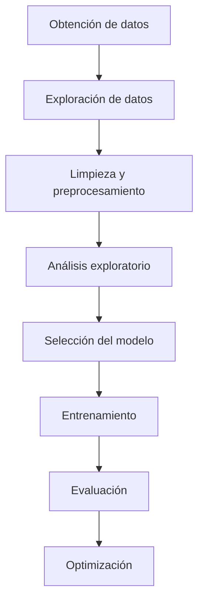

# Documentación inicial del proyecto

## 1. Estructura inicial del proyecto

El proyecto estará organizado de la siguiente manera:

```text
machine-learning/
├── data/
├── notebooks/
├── src/
│   └── main.py
├── models/
├── requirements.txt
├── README.md
├── documentacion.md
└── .gitignore
```

- `data/`: almacenamiento de los conjuntos de datos.
- `notebooks/`: análisis y experimentación con Jupyter Notebook.
- `src/`: código fuente del proyecto.
- `models/`: almacenamiento de los modelos entrenados.
- `requirements.txt`: dependencias del proyecto.
- `README.md`: presentación general del proyecto.
- `documentacion.md`: documentación técnica.
- `.gitignore`: archivos excluidos del control de versiones.

## 2. Documentación básica

El proyecto tiene como objetivo desarrollar un modelo de Machine Learning utilizando Python, desde la obtención de los datos hasta el entrenamiento y evaluación del modelo.

### Tecnologías

- Python
- Pandas
- NumPy
- Matplotlib
- Seaborn
- Scikit-learn
- Jupyter Notebook
- Git y GitHub

### Instalación de dependencias

```bash
pip install pandas numpy matplotlib seaborn scikit-learn jupyter
```

## 3. Primeros commits

Se propone realizar los siguientes commits iniciales:

| Commit | Descripción |
|---|---|
| Initial commit | Creación del repositorio |
| Add README | Documentación general |
| Add project structure | Organización de carpetas y archivos |
| Add documentation | Documentación técnica inicial |
| Add initial Python code | Código inicial del proyecto |

## 4. Bocetos, diagramas y análisis preliminares

El desarrollo del modelo seguirá el siguiente flujo de trabajo:



Durante la fase inicial se analizarán los siguientes aspectos:

- Selección del dataset.
- Identificación de las variables.
- Detección de valores nulos y duplicados.
- Selección del algoritmo de Machine Learning.
- Definición de las métricas de evaluación.

## 5. Código inicial

Como punto de partida, se plantea el siguiente código para cargar y explorar un conjunto de datos mediante Pandas:

```python
import pandas as pd

# Cargar dataset
df = pd.read_csv("data/dataset.csv")

# Mostrar las primeras filas
print(df.head())

# Información del dataset
df.info()

# Resumen estadístico
print(df.describe())

# Comprobar valores nulos
print(df.isnull().sum())
```

## Estado del proyecto

El proyecto se encuentra en su fase inicial de planificación y preparación del entorno de desarrollo.

La selección definitiva del dataset, el algoritmo y el entrenamiento del modelo se realizarán en las siguientes fases.
